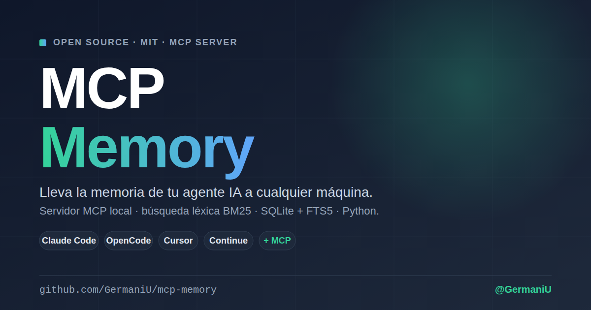

<p align="center">
  
</p>

**English** · [Español](README.md)

# MCP Memory — Local memory for AI agents via MCP

> **Bring your AI agent's memory to any machine.**
> Open source MCP server that gives persistent memory with lexical (BM25) search to Claude Desktop, Claude Code, OpenCode, Cursor, Continue, and any client compatible with the [Model Context Protocol](https://modelcontextprotocol.io). SQLite + FTS5, **zero external infra, 100% on your hardware**.

[](LICENSE)
[](https://modelcontextprotocol.io)
[](server/pyproject.toml)
[](https://github.com/GermaniU/mcp-memory/actions/workflows/ci.yml)
[](server/src/mcp_memory/shared/store.py)
[](CONTRIBUTING.md)

**Tags:** `mcp-server` · `ai-agents` · `sqlite` · `fts5` · `bm25` · `claude-code` · `cursor` · `opencode` · `lexical-search` · `agent-memory` · `local-first` · `self-hosted`

<p align="center">
  
</p>

<p align="center"><sub>The agent saves something in one session and recalls it in another — same SQLite file, new process. No cloud, no vectors, no extra services.</sub></p>

---

## 💡 Why it exists

AI agents forget everything between conversations. Existing solutions are cloud-only, heavy multi-tenant systems, or locked to a single client. **MCP Memory** solves this with three simple ideas:

1. **Your memory, your machine.** A single local SQLite file. Zero data in the cloud, zero external services to run.
2. **Connect once, works everywhere.** It's a standard MCP server — any client that speaks MCP uses it without custom code.
3. **Zero overhead.** `pip install` and you have 9 tools ready for your agent in seconds — no Docker, no models to pull.

---

## ⚡ Quickstart

There are two ways to run it. Pick one:

| Mode | When | How it starts |
|------|------|---------------|
| **stdio** | Claude Desktop, Claude Code, Cursor… (simplest) | The client launches the process itself. No background server, no port. |
| **HTTP** | Several clients against one server, Docker, web clients | You start it and it listens on `http://localhost:8765/mcp`. |

### Option A — stdio (nothing left running)

With [`uv`](https://docs.astral.sh/uv/) installed there's no need to clone: the client downloads and launches the server on every session. For Claude Code:

```bash
claude mcp add -s user mcp-memory -- uvx --from "git+https://github.com/GermaniU/mcp-memory#subdirectory=server" mcp-memory --stdio
```

For Claude Desktop, Cursor and the rest, the JSON config is in [`docs/CLIENTS.md`](docs/CLIENTS.md#modo-stdio-recomendado). Every process shares the same SQLite file (`DB_PATH`), so the memory is the same across all your clients.

### Option B — HTTP (background server)

```bash
git clone https://github.com/GermaniU/mcp-memory.git
cd mcp-memory/server
pip install -e .
mcp-memory
```

> Alternative without installing into your global environment: `uvx --from . mcp-memory` (run from inside `server/`).

No prerequisites: nothing to spin up, nothing to download. On startup the server creates the SQLite file (`DB_PATH`, default `~/.agent-memory/memory.db`) and its schema (a `memories` table + FTS5 index) if they don't exist yet.

MCP endpoint: `http://localhost:8765/mcp`. Paste it into your client's config (see [`docs/CLIENTS.md`](docs/CLIENTS.md) — Claude Code, OpenCode, Cursor, Continue).

> `mcp-memory --stdio` (or `MCP_TRANSPORT=stdio`) starts stdio mode from a local install.

### 🔍 Diagnostics & Health Check

Verify your Python has FTS5 compiled and that `DB_PATH` is accessible, instantly:

```bash
mcp-memory check
```

`mcp-memory --help` lists the commands and environment variables; `mcp-memory --version` prints the installed version.

---

## 🛠 Exposed MCP tools

| Tool             | Kind | What it does |
|------------------|------|--------------|
| `memory_save`    | ✏️ write | Save text + tags + metadata. |
| `memory_search`  | 👁 read | Lexical search (BM25 via SQLite FTS5) with namespace filter. |
| `memory_update`  | ⚠️ destructive | Update content/tags/metadata by id. Re-syncs the FTS5 index if content changes. Rejects empty `content`. |
| `memory_delete`  | ⚠️ destructive | Delete by id. |
| `memory_list`    | 👁 read | Paginated listing by namespace. |
| `memory_recent`  | 👁 read | The last N entries by `updated_at`. |
| `memory_stats`   | 👁 read | Count, namespaces, oldest/newest. |
| `memory_export`  | 👁 read | Export all memories (or a namespace) as JSONL. Returns `count` and a `jsonl` string. |
| `memory_import`  | ✏️ write | Import a JSONL string produced by `memory_export`. Skips id collisions silently. Accepts optional `namespace_override`. |

The **Kind** is published as [MCP tool annotations](https://modelcontextprotocol.io/specification/2025-06-18/server/tools#tool-annotations) (`readOnlyHint`, `destructiveHint`): clients that support them can auto-approve reads and ask for confirmation before modifying or deleting. On connect, the server also sends `instructions` to the agent (when to search, when to save, how to phrase lexical queries).

Schemas and invocation examples in [`docs/CLIENTS.md`](docs/CLIENTS.md) (in Spanish).

---

## 🎯 Current scope

MCP Memory is deliberately small. It does **one thing well: lexical memory for plain text**. It is not a full RAG system, not a knowledge base, not a graph.

### What it DOES
- ✅ Stores and retrieves **plain text** in SQLite.
- ✅ Lexical search (BM25/FTS5) with a `namespace` filter.
- ✅ Free-form tags + metadata on every entry.
- ✅ 9 standard MCP tools for any compatible agent.
- ✅ Disk persistence (a single `.db` file), backup = copy the file.

### What it does NOT do (yet)
- ❌ **No semantic search.** It's lexical (BM25): it matches terms, not meaning — synonyms or paraphrases with no vocabulary overlap won't match.
- ❌ **No image or binary support.** Text only.
- ❌ **No PDFs or binary files** — extract the text before saving.
- ❌ **Not multi-tenant.** One person, one machine, one memory (namespaces separate contexts).
- ❌ **No built-in UI.** Manage it from your agent or via curl/MCP.
- ❌ **No cross-machine sync.** Manual backup (copy the `.db` file) if you want to move data.
- ❌ **No auth.** In HTTP mode it listens on `localhost` only, with CORS closed (in stdio mode it opens no port). If you expose it to the internet, put an auth proxy in front. See [`SECURITY.md`](SECURITY.md).

If you need something from the NO list, open an [issue](https://github.com/GermaniU/mcp-memory/issues) with a real (not speculative) use case — we add things on demand, not on speculation.

---

## 🧭 How does it compare to the official `server-memory`?

The official MCP ships [`server-memory`](https://github.com/modelcontextprotocol/servers/tree/main/src/memory) (`@modelcontextprotocol/server-memory`). They don't compete for the same job: that one is a **knowledge graph**; this one is **lexical memory for text**. Pick by what you need to remember.

| | **MCP Memory** (this) | **`server-memory`** (official) |
|---|---|---|
| Data model | Flat text entries (`content` + `tags` + `metadata`) | Graph: entities + relations + observations |
| Storage | One **SQLite** file with an **FTS5** index | One **JSONL** file holding the whole graph |
| Search | **Ranked BM25** (FTS5), filtered by `namespace` | `search_nodes`: *substring* match over name/type/observations, **no ranking** |
| Namespaces | ✅ one pool per project or agent | ❌ |
| Free-form tags / metadata | ✅ per entry | ❌ |
| Export / import | ✅ `memory_export` / `memory_import` (JSONL) | ❌ read and write the file by hand |
| Transport | **stdio + Streamable HTTP** | stdio |
| Cost of reading | Ranking in SQLite: you fetch only the hits | `read_graph` returns the entire graph |

**In one sentence:**
- If your problem is **facts with relations** ("Ana *works_at* Acme", "*parent_of*…"), use the official graph.
- If your problem is **remembering notes and decisions and finding them by keyword**, split by project, with export/import, use MCP Memory.

It's not "better than": it's **a different tool for a different job** — and the one that doesn't make you load the whole graph on every query.

---

## 🔌 Connect your client

Ready-to-paste config snippets in [`docs/CLIENTS.md`](docs/CLIENTS.md) (in Spanish; stdio and HTTP):

- 🟫 **Claude Desktop** — `claude_desktop_config.json` with `"command": "uvx"` (stdio).
- 🟦 **Claude Code** — `claude mcp add -s user mcp-memory -- uvx --from "git+https://github.com/GermaniU/mcp-memory#subdirectory=server" mcp-memory --stdio`, or over HTTP `claude mcp add -s user -t http mcp-memory http://localhost:8765/mcp` (tools show up in new sessions).
- 🟧 **Cursor** — Settings → MCP Servers → Add new MCP Server.
- 🟩 **Continue** (VS Code / JetBrains) — `~/.continue/config.json`.
- 🟪 **OpenCode** — `~/.config/opencode/config.json`.

Ready-to-use JSON snippets in [`examples/`](examples/).

---

## 🧪 Smoke test with curl

To validate the stack without needing an MCP client:

```bash
SESSION=$(curl -sS -D - -o /dev/null -X POST http://localhost:8765/mcp \
  -H 'Content-Type: application/json' \
  -H 'Accept: application/json, text/event-stream' \
  -H 'MCP-Protocol-Version: 2025-06-18' \
  -d '{"jsonrpc":"2.0","id":1,"method":"initialize","params":{"protocolVersion":"2025-06-18","capabilities":{},"clientInfo":{"name":"smoke","version":"0.1"}}}' \
  | tr -d '\r' | awk '/^mcp-session-id:/{print $2}')

curl -sS -X POST http://localhost:8765/mcp \
  -H 'Content-Type: application/json' \
  -H 'Accept: application/json, text/event-stream' \
  -H 'MCP-Protocol-Version: 2025-06-18' \
  -H "mcp-session-id: $SESSION" \
  -d '{"jsonrpc":"2.0","method":"notifications/initialized"}'

curl -sS -X POST http://localhost:8765/mcp \
  -H 'Content-Type: application/json' \
  -H 'Accept: application/json, text/event-stream' \
  -H 'MCP-Protocol-Version: 2025-06-18' \
  -H "mcp-session-id: $SESSION" \
  -d '{"jsonrpc":"2.0","id":2,"method":"tools/call","params":{"name":"memory_save","arguments":{"content":"works end-to-end","namespace":"smoke","tags":["ok"]}}}'
```

---

## 🧱 Architecture (vertical slice)

```
┌─ your agent (Claude Code / OpenCode / Cursor / …) ─┐
│           │ MCP streamable HTTP                     │
│           ▼                                         │
│    localhost:8765/mcp                               │
└────────────┬────────────────────────────────────────┘
             │
   ┌─────────▼────────┐
   │   mcp-memory     │
   │   (Python+MCP)   │
   └─────────┬────────┘
             │
             ▼
   ┌──────────────────────────┐
   │  SQLite (local file)     │  ← memories + memories_fts (FTS5/BM25)
   └──────────────────────────┘
```

Each MCP tool lives in its own folder (`server/src/mcp_memory/tools/<tool>/handler.py`). Adding a new tool = adding a folder + a decorator in `server.py`. Zero coupling.

Technical details in [`docs/ARCHITECTURE.md`](docs/ARCHITECTURE.md) (in Spanish).

---

## 🤝 Contributing

MCP Memory is **a gift to the community** — MIT, no strings attached. PRs, issues, and forks are welcome.

**Rules (summary):**
1. **Clean Code · SOLID · KISS · YAGNI · Vertical slice · Tests first.** PRs without tests for new logic will not be accepted.
2. **Identifiers in English**, comments and commits in Spanish. Conventional Commits (`feat:`, `fix:`, `docs:`, `refactor:`, `test:`, `chore:`).
3. **One new tool = one new folder.** Do not touch existing slices unless fixing a bug.
4. **DIP**: external dependencies behind a `Protocol` so tests don't need external services.
5. **No speculative abstractions.** If there's only 1 implementation, there's no interface.
6. **Document the WHY, not the WHAT.** The function name already tells you what.

Full details and step-by-step workflow in [`CONTRIBUTING.md`](CONTRIBUTING.md).

```bash
# Local development setup
cd server
python -m venv .venv && source .venv/bin/activate
pip install -e ".[dev]"
pytest tests/unit -q          # 81 unit tests, ~1s
pytest tests/integration -q   # 17 real E2E tests against SQLite/FTS5 (stdio included), no external services
ruff check src tests scripts
```

---

## 🩹 Troubleshooting (real errors I already hit)

**`no such module: fts5` on startup**
- Your Python doesn't have FTS5 compiled into its `sqlite3` module (common on some Linux builds). Use the Homebrew/python.org Python (macOS/Windows) or install `libsqlite3-dev` before compiling Python (Linux, pyenv/asdf). Verify with `mcp-memory check`.

**`Connection reset by peer` when running `curl http://localhost:8765/mcp`**
- The `Accept: application/json, text/event-stream` header is missing. Without it, FastMCP closes the connection.

**`memory_search` returns empty results**
- Same namespace? If you saved without a namespace, search with `default`. Remember search is lexical (BM25): the query needs to share terms with the saved content, not just meaning.

**`mcp-memory` won't start / permission error on `DB_PATH`**
- The parent directory of `DB_PATH` isn't writable. `mcp-memory check` validates this explicitly before failing at runtime.

**I want to move my memory to another machine**
- Copy the `DB_PATH` file (default `~/.agent-memory/memory.db`) — it's self-contained, there's no other state to migrate.

---

## 📚 Documentation

- [`docs/INSTALL.md`](docs/INSTALL.md) (in Spanish) — detailed installation, environment variables, extended troubleshooting.
- [`docs/CLIENTS.md`](docs/CLIENTS.md) (in Spanish) — config for Claude Code, OpenCode, Cursor, Continue.
- [`docs/ARCHITECTURE.md`](docs/ARCHITECTURE.md) (in Spanish) — technical decisions and rationale.
- [`SECURITY.md`](SECURITY.md) (in Spanish) — threat model and how to report vulnerabilities.
- [`CONTRIBUTING.md`](CONTRIBUTING.md) — disciplines, workflow, how to add a tool.
- [`CHANGELOG.md`](CHANGELOG.md) (in Spanish) — release history.

---

## 📄 License

[MIT](LICENSE) — use it, fork it, give more people local memory.

---

**Made by [@GermaniU](https://github.com/GermaniU)** with professional software disciplines. If it has been useful to you, a ⭐ helps more people find it. If it broke something, open an issue and we'll fix it.
